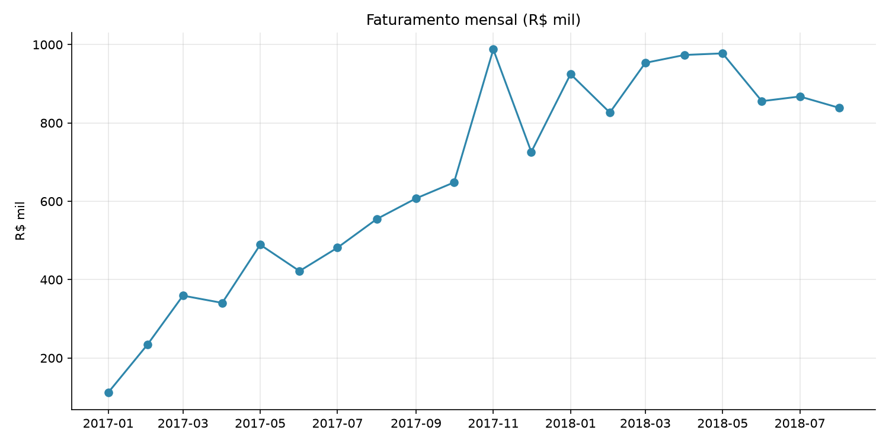
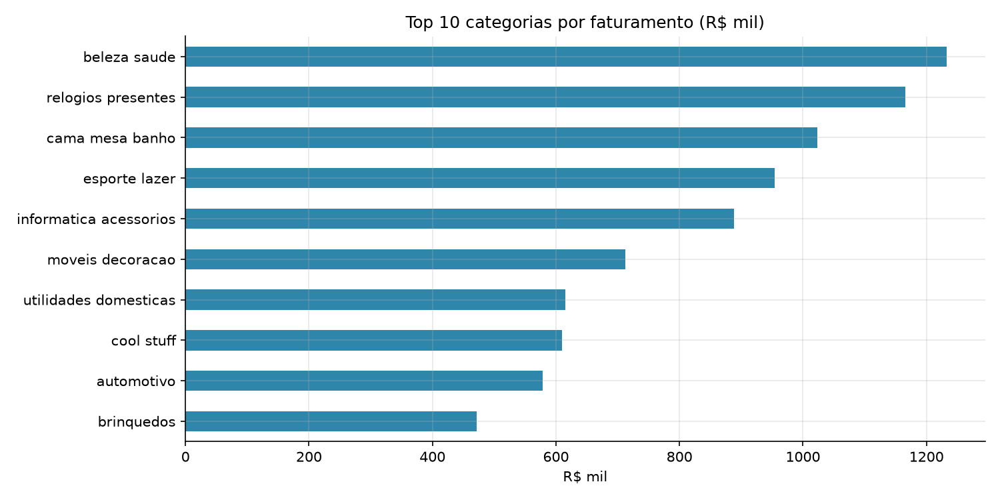
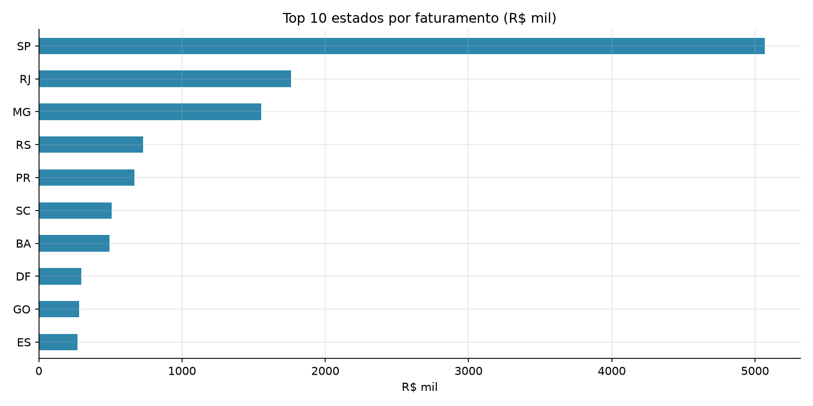
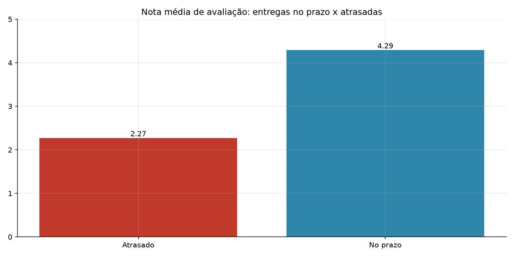

# 📊 Análise de Vendas do E-commerce Brasileiro (Olist)

Análise exploratória de cerca de 100 mil pedidos reais de um marketplace brasileiro, com foco em faturamento, desempenho logístico e satisfação do cliente.

## 🎯 Objetivo

Responder a perguntas de negócio a partir dos dados:

1. Como o faturamento evoluiu ao longo do tempo?
2. Quais categorias e estados mais geram receita?
3. A empresa cumpre os prazos de entrega?
4. Atrasos na entrega afetam a avaliação do cliente?

## 🛠️ Tecnologias

- **Python** (Pandas e Matplotlib)
- **Git e GitHub**

## 🔄 Etapas do projeto

1. **Carregamento** das tabelas de pedidos, itens, clientes, produtos e avaliações
2. **Verificação de qualidade:** identificação de valores nulos e registros duplicados
3. **Tratamento:** conversão de datas, filtro de pedidos entregues e cálculo de prazos
4. **Junção** das tabelas em uma base única de análise
5. **Cálculo de KPIs** e geração de gráficos
6. **Automação:** o script atualiza este README com os resultados a cada execução

## 📈 Resultados

<!-- RESULTADOS_INICIO -->
| Indicador | Resultado |
|---|---|
| Faturamento total | R$ 13.220.248,93 |
| Pedidos entregues | 96.470 |
| Ticket médio | R$ 137,04 |
| Entregas no prazo | 93,2% |
| Prazo médio de entrega | 12,1 dias |
| Nota média de avaliação | 4,16 / 5 |

### Principais conclusões

- **Beleza saude** é a categoria com maior faturamento.
- **SP** concentra 38,3% do faturamento total.
- Pedidos entregues com atraso recebem nota média de **2,27**, contra **4,29** dos entregues no prazo: o cumprimento do prazo é um fator decisivo na satisfação do cliente.
<!-- RESULTADOS_FIM -->

### Faturamento mensal

### Top 10 categorias

### Top 10 estados

### Impacto do atraso na avaliação

## ▶️ Como executar

1. Clone o repositório
2. Baixe a base [Brazilian E-Commerce Public Dataset by Olist](https://www.kaggle.com/datasets/olistbr/brazilian-ecommerce) e coloque os arquivos `.csv` na pasta `dados/`
3. Instale as dependências: `pip install -r requirements.txt`
4. Execute: `python analise.py`

## 📫 Contato

**Márcio Oliveira**
- E-mail: mvsao.dev@icloud.com
- GitHub: [MarciioSantos](https://github.com/MarciioSantos)
